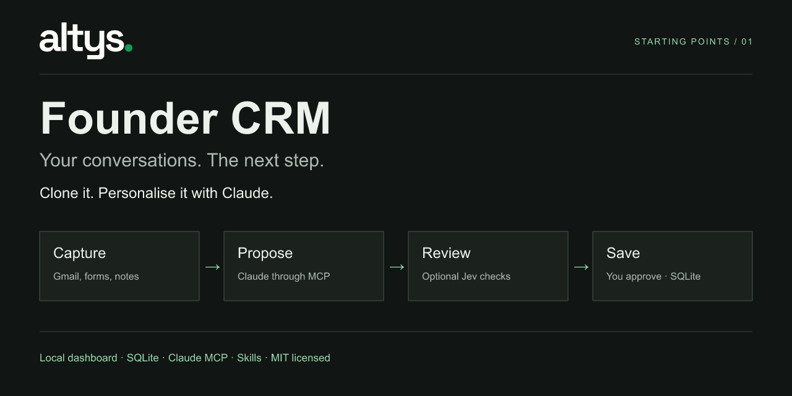
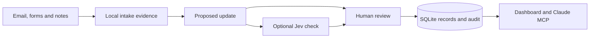

# Founder CRM

A small, local CRM for the first customers, conversations and promises of an early startup. Built by **Altys** as a starting point you can clone and personalise with Claude.

Keep relationships, follow-ups, customer requests and source evidence in SQLite. Use the dashboard to look around, or connect Claude through MCP to ask questions and propose updates. Optional Jev checks can assess whether the evidence supports a proposed change. You review before saving.

**Python 3.11+ · SQLite · MIT · No account or API key needed for the demo**

[Quick start](#quick-start) · [Use with Claude](#use-with-claude) · [Connect services](#optional-integrations) · [Architecture](docs/architecture.md) · [Contributing](CONTRIBUTING.md)

## Quick start

```sh
git clone https://github.com/shlok97/founder-crm.git
cd founder-crm
python3 scripts/start.py
```

Open **http://127.0.0.1:4780**. You get a working dashboard with fictional people and conversations. Running it again preserves your demo changes. Stop with **Ctrl+C**.

The dashboard has no third-party runtime dependencies, frontend build or external database. The launcher uses Python 3.11+; if your default Python is older, it can find an already installed compatible interpreter. It does not download Python or connect accounts. You can also run `python3.12 scripts/start.py` explicitly. On Windows, use `py -3.12 scripts/start.py`.

Start your own empty workspace when you are ready:

```sh
python3 scripts/start.py --empty
```

Demo records live in `data/demo.db`; your empty workspace uses `data/crm.db`. Both are ignored by Git. Use `--port 4782` if the default port is busy, or `--db path/to/my.db` to choose a different file.


## What it does

| View | What you can do |
|---|---|
| Today | Review next steps, complete follow-ups and find fixes without recorded customer updates |
| Intake | Capture conversation notes and inspect imported messages or form submissions |
| Review | Inspect source evidence, target records, proposed changes and optional Jev judgments; approve or reject |
| Relationships | Keep customers, prospects, investors, partners and vendors distinct; inspect their history |
| Pipeline | Track customer opportunities from discovery to won or lost |
| Connections | Configure the optional integrations when you need them |

An investor can need a follow-up without becoming a sales lead. A meeting under discussion is not a booked meeting. A deployed fix is not proof that the customer was told. Those distinctions are part of the model, rather than notes you have to remember.

## Use with Claude

### Personalise the app

Open this checkout in **Claude Code** and describe one concrete change:

> I run a small design agency. Add an optional owner to each relationship, show it in the dashboard, and preserve my existing records when upgrading SQLite. Keep human review and add tests.

The project includes `CLAUDE.md`, operating rules and three skills for daily review, conversation capture and proposal review. Start with fictional records, inspect the changes, then try them in the browser.

We tested the agency-owner customisation through Claude Code. The first pass needed an upgrade correction; the reviewed extension passes 44 tests. [See the example and apply its patch](docs/personalisation-test.md), or read [more personalisation prompts](docs/personalise.md).

### Connect the CRM as an MCP server

Install the optional MCP adapter in a virtual environment using Python 3.11+:

```sh
python3 -m venv .venv
source .venv/bin/activate
python -m pip install -e '.[mcp]'
claude mcp add --transport stdio founder-crm -- "$(pwd)/.venv/bin/founder-crm" --db "$(pwd)/data/crm.db" mcp
```

On Windows, use `.venv\Scripts\activate` and the absolute path to `.venv\Scripts\founder-crm.exe`. An equivalent project configuration is in [.mcp.json.example](.mcp.json.example).

Use the **same absolute database path** for the dashboard and MCP server. Try “What do I owe people today?” or “Capture this call note and propose a follow-up.” MCP can read, capture and propose; approval stays in the dashboard or human CLI. The AI client you connect can read the records returned by its tools.

## Optional integrations

| Service | Role | Setup |
|---|---|---|
| Gmail | Explicit, bounded, read-only email pulls; no sends, labels or archives | Your own Google OAuth client; install the `gmail` extra |
| Web3Forms | Website submissions become intake evidence | A supported Web3Forms plan and your own HTTPS relay to the dedicated webhook path |
| Jev | Advisory supported / unsupported / insufficient judgments on proposed updates | Your own TypeSafe or OpenRouter key; model sharing defaults off |
| Claude MCP | Read records, capture notes and stage changes from Claude | Install the `mcp` extra and register the local stdio server |

The demo works without any of these. No credentials are bundled or loaded from another project. See [integration setup](docs/integrations.md) and [.env.example](.env.example). The example environment file is a reference and is not loaded automatically.

## How it works



Proposals freeze their source, relationship and target context. Applied changes have an audit record. Duplicate intake IDs are ignored, and stale or changed proposal evidence requires a fresh proposal. Jev advises; it never applies updates.

[Architecture and schema](docs/architecture.md) · [Editable flow diagram](docs/images/architecture.svg)

## Project layout

```text
founder_crm/core.py          SQLite records, proposals, approval and audit
founder_crm/schema.sql       The database schema
founder_crm/web.py           Local HTTP server and dashboard routes
founder_crm/static/          Build-free HTML, CSS and JavaScript
founder_crm/integrations.py  Gmail and Web3Forms adapters
founder_crm/judge.py         Optional Jev adapter
founder_crm/mcp_server.py    Claude MCP tools
.claude/skills/              Three reusable operating skills
scripts/start.py            No-install demo or empty-workspace launcher
tests/                      Synthetic workflow and integration tests
```

## Development and checks

Install `.[mcp,gmail]` in your virtual environment to exercise all optional adapters, then run:

```sh
python -m unittest discover -s tests -v
node --check founder_crm/static/app.js
```

The base suite has **39 tests**. Fixtures cover Gmail, Web3Forms and Jev without calling those services. The optional agency-owner extension adds five regression tests. [Verification details](docs/verification.md) distinguish local workflow checks from live service tests.

## Scope and data

This is an early, single-user local starter. It has no remote login, hosted sync, background email automation or automatic outbound messages. Keep the dashboard on loopback; expose only the dedicated webhook route if you configure a relay.

The repository contains **fictional demo records and synthetic fixtures**. It contains no Altys customer database, messages, contact exports, credentials or private trial evidence. Keep your own data and tokens under ignored `data/`, and back up the SQLite file with processes stopped before trying schema changes.

## Contributing and licence

Small improvements grounded in a real workflow are welcome. See [contributing](CONTRIBUTING.md), [security reporting](SECURITY.md) and the [MIT licence](LICENSE).

Built by **Altys**. Clone it, make it yours, and share what you learn.
