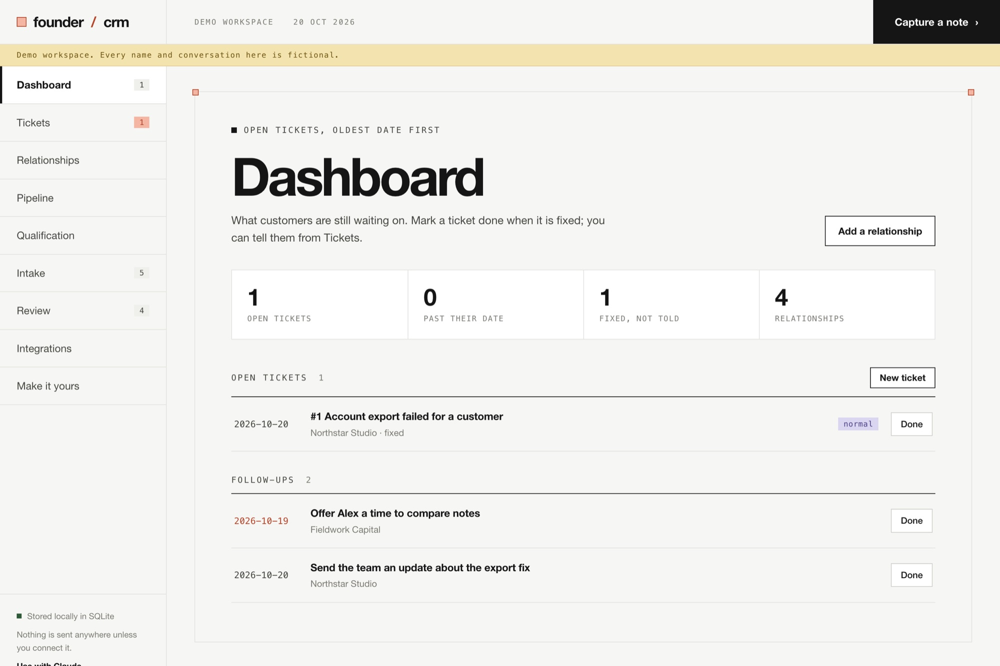
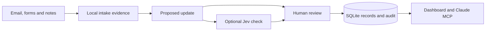

# Founder CRM

A small, local CRM for the first customers, conversations and promises of an early startup. Built by **Altys** as a starting point you can clone and personalise with Claude.

Keep relationships, follow-ups, customer requests and source evidence in SQLite. Use the dashboard to look around, or connect Claude through MCP to ask questions and propose updates. Optional Jev checks can assess whether the evidence supports a proposed change. You review before saving.

**Python 3.11+ · SQLite · MIT · No account or API key needed for the demo**

[Quick start](#quick-start) · [Use with Claude](#use-with-claude) · [Connect services](#optional-integrations) · [Architecture](docs/architecture.md) · [Contributing](CONTRIBUTING.md)

## Quick start

```sh
git clone https://github.com/shlok97/founder-crm.git
cd founder-crm
python3 scripts/start.py
```

Open **http://127.0.0.1:4780**. You get a working dashboard with fictional people and conversations. Running it again preserves your demo changes. Stop with **Ctrl+C**.

The dashboard has no third-party runtime dependencies, frontend build or external database. The launcher uses Python 3.11+; if your default Python is older, it can find an already installed compatible interpreter. It does not download Python or connect accounts. You can also run `python3.12 scripts/start.py` explicitly. On Windows, use `py -3.12 scripts/start.py`.

Start your own empty workspace when you are ready:

```sh
python3 scripts/start.py --empty
```

Demo records live in `data/demo.db`; your empty workspace uses `data/crm.db`. Both are ignored by Git. Use `--port 4782` if the default port is busy, or `--db path/to/my.db` to choose a different file.



## What it does

| View | What you can do |
|---|---|
| Dashboard | Every open ticket, oldest date first, each one click from done (with undo) |
| Intake | Capture conversation notes and inspect imported messages or form submissions |
| Review | Inspect source evidence, target records, proposed changes and optional Jev judgments; approve or reject |
| Relationships | Keep customers, prospects, investors, partners and vendors distinct; inspect their history |
| Pipeline | Track customer opportunities from discovery to won, lost or parked, with value, probability and a dated next step |
| Tickets | Log what a customer reports, move it to fixed and closed, and record when and how you told them |
| Qualification | Answer whether an account can and will buy, with a source for every claim and a queue of the gaps |
| Integrations | Configure Gmail, web forms, Claude and Jev when you need them |
| Make it yours | A step-by-step setup with Claude Code or Codex: bring your old records, connect your channels, add your own fields |

An investor can need a follow-up without becoming a sales lead. A meeting under discussion is not a booked meeting. A deployed fix is not proof that the customer was told. Those distinctions are part of the model, rather than notes you have to remember.

The same workflows run from the command line, which is how a Claude Code session or a script records things as they happen:

```sh
founder-crm ticket add "Export returns 504" --account "Paper Kite" \
    --kind bug --severity high --via whatsapp --body "the export just spins" \
    --next-action "raise the proxy timeout" --due 2026-10-25
founder-crm tickets                    # open tickets, worst first
founder-crm ticket close 12 --resolution "exports finish again" --release v1.4
founder-crm untold                     # fixed or closed, customer not yet told
founder-crm ticket notify 12 --via whatsapp --note "Told Sam exports work again"
founder-crm followups                  # every dated next step in one list
founder-crm qualify gaps               # buyers still missing qualification answers
founder-crm qualify set "Paper Kite" team_size=4 fit_score=4 pain_points="manual reports"
founder-crm qualify evidence "Paper Kite" "4 analysts" --source "call, 2026-10-01"
founder-crm log call --account "Paper Kite" --summary "walked the export" --at 2026-10-18
founder-crm show "Paper Kite"          # the whole record
```

Add `--db path/to/crm.db` to point at your workspace. A person recording "I told them on WhatsApp" is kept apart from a Gmail-verified sent message: both close the loop, and the record says which one it was.

## Use with Claude

### Personalise the app

Open this checkout in **Claude Code** and describe one concrete change:

> I run a small design agency. Add an optional owner to each relationship, show it in the dashboard, and preserve my existing records when upgrading SQLite. Keep human review and add tests.

The project includes `CLAUDE.md`, operating rules and three skills for daily review, conversation capture and proposal review. Start with fictional records, inspect the changes, then try them in the browser.

We tested an agency-owner customisation through Claude Code on version 0.1.1; the first pass needed an upgrade correction. From 0.2 an owner is built in, so that patch is kept as a worked example rather than applied. [Read the example](docs/personalisation-test.md), [more personalisation prompts](docs/personalise.md), or [Make it yours](#make-it-yours) for changes that need no code.

### Connect the CRM as an MCP server

Install the optional MCP adapter in a virtual environment using Python 3.11+:

```sh
python3 -m venv .venv
source .venv/bin/activate
python -m pip install -e '.[mcp]'
claude mcp add --transport stdio founder-crm -- "$(pwd)/.venv/bin/founder-crm" --db "$(pwd)/data/crm.db" mcp
```

On Windows, use `.venv\Scripts\activate` and the absolute path to `.venv\Scripts\founder-crm.exe`. An equivalent project configuration is in [.mcp.json.example](.mcp.json.example).

Use the **same absolute database path** for the dashboard and MCP server. The default launcher demo uses `data/demo.db`; use that path in the MCP command to explore the same demo, or run `python3 scripts/start.py --empty` for your personal `data/crm.db`. MCP initializes a missing database as an empty workspace. Try “What do I owe people today?” or “Capture this call note and propose a follow-up.” MCP can read, capture and propose; approval stays in the dashboard or human CLI. The AI client you connect can read the records returned by its tools.

## Make it yours

Every business tracks something nobody else does: a licence number, a plan tier, which region a client sits in, an industry-specific qualification question. Founder CRM gives you three levels, and you should reach for them in this order.

The **Make it yours** view in the app walks through this as seven steps, each with a command or a prompt to paste into Claude Code or Codex: get your own copy, start an empty workspace, bring your existing records (spreadsheet, CRM export, database) in without losing a field, connect the channels your customers use (email, WhatsApp, Slack, calls, forms), add your own fields, keep your data out of Git, and make it part of your day.

**1. Custom fields, no code.** Define a field once and it can be set on any relationship, contact, opportunity, ticket, interaction or event. Values are type-checked (text, number, integer, date, boolean, choice, JSON). Use the **Make it yours** view in the dashboard, or:

```sh
founder-crm field define account plan_tier "Plan tier" --type choice --choices free,team,enterprise
founder-crm set "Paper Kite" plan_tier=team segment=agency
founder-crm field define ticket customer_ref "Customer reference"
founder-crm ticket set 12 customer_ref=INC-2041
```

**2. Your own qualification questions.** Mark an account field with `--qualification` and it joins the built-in questions (entity, team size, tools, pain points, use case, budget authority, decision process, fit). It counts toward each account's completeness and appears in the Qualification queue and form:

```sh
founder-crm field define account annual_budget "Annual budget band" \
    --type choice --choices under_10k,10k_50k,over_50k --qualification
```

Leave unknown answers empty rather than guessing; an empty answer keeps the account in the queue.

**3. Change the app with Claude.** For a new view, a new rule or a built-in field that deserves its own column, open this checkout in Claude Code and describe one concrete change (see [Use with Claude](#use-with-claude) and [personalisation prompts](docs/personalise.md)). A built-in field needs `schema.sql`, the `EDITABLE` list in `core.py`, and a test; `Store.init` upgrades an existing database by copying every changed table into its new shape and writes a backup first.

**Moving in from another CRM or spreadsheet.** Write a small import script against `Store`: create records with `add_account`, `add_contact`, `open_ticket` and friends, put anything without a built-in home into custom fields, and record each source row in the `import_ids` table (`source`, `source_table`, `source_id` → new record) so a re-run updates rather than duplicates. Keep the script and its data outside this repository.

## Optional integrations

| Service | Role | Setup |
|---|---|---|
| Gmail | Explicit, bounded, read-only email pulls; no sends, labels or archives | Your own Google OAuth client; install the `gmail` extra |
| Web3Forms | Website submissions become intake evidence | A supported Web3Forms plan and your own HTTPS relay to the dedicated webhook path |
| Jev | Advisory supported / unsupported / insufficient judgments on proposed updates | Your own TypeSafe or OpenRouter key; model sharing defaults off |
| Claude MCP | Read records, capture notes and stage changes from Claude | Install the `mcp` extra and register the local stdio server |

The demo works without any of these. No credentials are bundled or loaded from another project. See [integration setup](docs/integrations.md) and [.env.example](.env.example). The example environment file is a reference and is not loaded automatically.

## How it works



Proposals freeze their source, relationship and target context. Applied changes have an audit record. Duplicate intake IDs are ignored, and stale or changed proposal evidence requires a fresh proposal. Jev advises; it never applies updates.

[Architecture and schema](docs/architecture.md) · [Editable flow diagram](docs/images/architecture.svg)

## Project layout

```text
founder_crm/core.py          SQLite records, workflows (tickets, qualification, custom fields), proposals, approval and audit
founder_crm/schema.sql       The database schema
founder_crm/web.py           Local HTTP server and dashboard routes
founder_crm/static/          Build-free HTML, CSS and JavaScript
founder_crm/integrations.py  Gmail and Web3Forms adapters
founder_crm/judge.py         Optional Jev adapter
founder_crm/mcp_server.py    Claude MCP tools
.claude/skills/              Three reusable operating skills
scripts/start.py            No-install demo or empty-workspace launcher
tests/                      Synthetic workflow and integration tests
```

## Development and checks

Install `.[mcp,gmail]` in your virtual environment to exercise all optional adapters, then run:

```sh
python -m unittest discover -s tests -v
node --check founder_crm/static/app.js
```

The base suite has **53 tests**, including a v1-to-v2 database upgrade, the ticket fix/close/told loop, qualification completeness with custom questions, and custom-field validation. A real local HTTP/MCP workflow connects form intake, proposal, advisory judgment and human approval in one database. Provider responses are synthetic; the suite does not call Gmail, Web3Forms or Jev. [Release review](docs/release-review.md) and [verification details](docs/verification.md) distinguish installed-package checks from live service tests.

## Scope and data

This is an early, single-user local starter. It has no remote login, hosted sync, background email automation or automatic outbound messages. Keep the dashboard on loopback; expose only the dedicated webhook route if you configure a relay.

The repository contains **fictional demo records and synthetic fixtures**. It contains no Altys customer database, messages, contact exports, credentials or private trial evidence. Keep your own data and tokens under ignored `data/`, and back up the SQLite file with processes stopped before trying schema changes.

## Contributing and licence

Small improvements grounded in a real workflow are welcome. See [contributing](CONTRIBUTING.md), [security reporting](SECURITY.md) and the [MIT licence](LICENSE).

Built by **Altys**. Clone it, make it yours, and share what you learn.

Maintainers: use the documented [Git push workflow](docs/maintaining.md), including the source/privacy pre-push hook.
