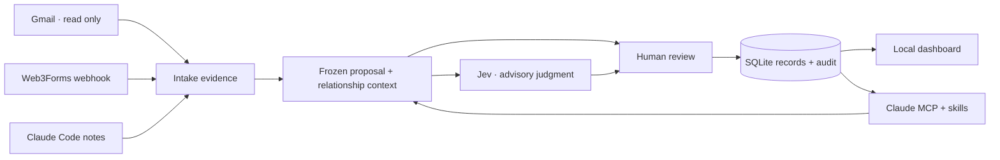
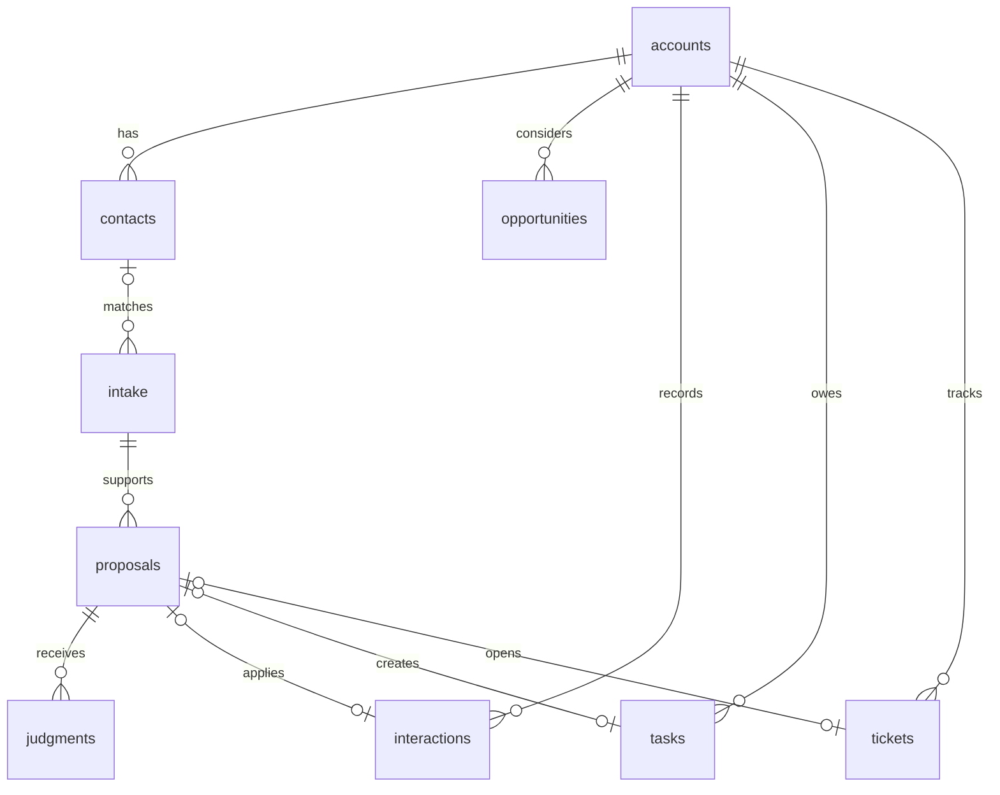

# Architecture

The dashboard runs on `127.0.0.1`. It serves its own scripts and styles, checks Host and Origin, and requires a per-process CSRF token for changes. It has no remote authentication or multi-user access. Any relay must expose only the webhook path, never the dashboard or `/api` routes.

## Records

Relationship (`customer`, `investor`, `vendor`, etc.) is distinct from lifecycle (`new`, `pilot`, `active`, etc.) and opportunity stage. Only customer/prospect accounts can enter the sales pipeline. Ticket fix, close and notification timestamps are separate. A notification records how the customer was told and whether it was a Gmail-verified sent message or a person's own record.

Schema v2 adds `qualification` and `qualification_evidence` (one dossier per account; completeness counts the built-in questions plus account custom fields marked as qualification questions), `sources`, `events` and `event_contacts`, `field_definitions` and `custom_values` (typed custom fields on any record), and `import_ids` (where an imported record came from, for idempotent imports). Interactions carry `occurred_at`, `kind` and `channel` as well as the time they were written down.

People write directly through the dashboard and CLI, with an audit row per change. Email, forms and Claude still go through proposals and human approval.

Intake deduplicates on `(source, external_id)`. Email contact matching is exact and case-insensitive; unknown senders remain unmatched. This starter does not infer company identity from domains or create contacts from messages. Link a contact before pulling a message when you need an automatic match. Already captured evidence is not silently rewritten.

## Proposal boundary

A proposal freezes the source, known account, five recent interactions, target record and its account, action and payload. The target lets the judge inspect ticket status or opportunity stage rather than guessing from an ID. A SHA-256 fingerprint ties the judgment to that snapshot. This detects accidental changes, not malicious edits by someone with filesystem access. Applying checks the fingerprint, unchanged source, target and account context. SQLite transactions serialize competing writes; a resolved proposal cannot apply twice.

Actions: log an interaction, create a task, open a ticket, record a fix, record a notification, set relationship, set opportunity stage. Direct human forms can add accounts, contacts and opportunities. MCP can capture evidence and stage proposals but cannot approve them. Local CLI/file access remains trusted; this is a workflow boundary, not an isolation sandbox for an untrusted coding agent.

Notification approval additionally requires a fixed ticket and outbound evidence pulled through Gmail, addressed to a matched contact on that account. Multi-recipient mail is left unmatched. A person must still read the actual sent text: the adapter proves a sent-message source, not that it communicates this particular fix or that someone read it.

Jev receives the full frozen context and candidate action only on an explicit judge request with model sharing enabled. It returns an advisory choice and confidence. Provider/network/format failures leave the proposal pending. No model result is required for manual approval, and no result bypasses review. Model confidence is not measured accuracy. Usage/cost remain unavailable unless returned by the provider.

## Storage and release

SQLite foreign keys are enabled per connection and writes use `BEGIN IMMEDIATE`. The database is mode 0600 on initialization. OAuth tokens are stored beside the configured database, mode 0600. Keep that directory private; local disk encryption and backups are the operator's responsibility.

No mail or private CRM data ships with the repository. Demo entities use `.example` addresses. Source packaging uses an explicit file allowlist; databases, credentials, virtual environments and private configuration are excluded.
